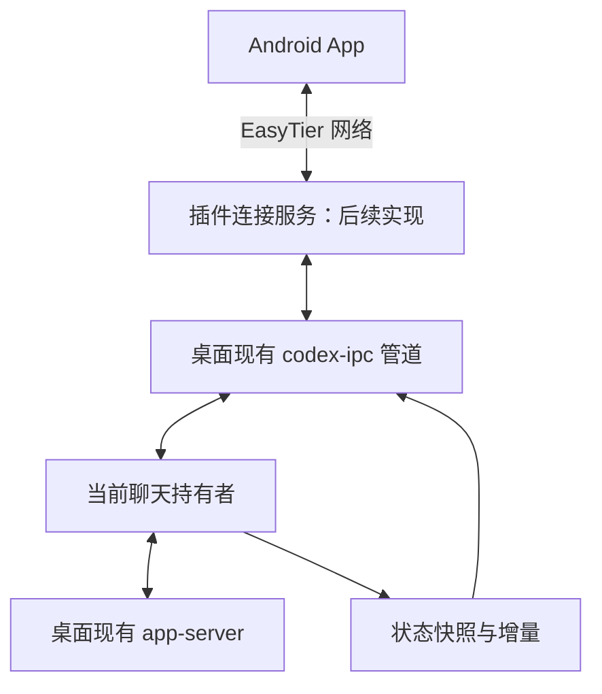

# 桌面现有会话实时接入验证

验证日期：2026-10-15（北京时间）。桌面应用版本 `26.1007.9446.0`，桌面 Codex 运行版本 `0.162.0-alpha.17.2`。

后续进展：已在用户授权的专用聊天中完成真实任务、队列、steer、会话打断与审批测试，并发现进程停止限制，详见 [完整控制流程验证](完整控制流程验证.md)。下文保留只读接入阶段的验证记录。

## 结论

**找到并实测打通了读取现有桌面会话和接收实时状态的本机入口。** 桌面应用有一个本地协调管道 `\\.\pipe\codex-ipc`，可以发现会话持有者，并向持有者发送跟随客户端请求。

独立探测程序接入这个已存在的管道后，读取到了当前聊天的设置和状态。在 20 秒的观察中，收到了 **1 份快照和 29 批增量**；快照 ID 与当前聊天一致，增量版本号连续，未发现缺口。

没有启动第二个 app-server，没有恢复第二个会话写入者，也没有发送模型任务、打断任务、回答审批、修改桌面安装文件或修改 EasyTier 配置。

这修正了前一轮验证的范围：独立 app-server 的 writer lock 路线仍然失败，但已有桌面的本地客户端协调入口可以读取和订阅同一会话。

**这是安装版本中的内部协议，不是已公开、承诺稳定的插件 SDK。** 后续产品需要限制兼容版本、处理协议变更与断线、实现设备认证，任务提交和审批仍需单独验证。

## 发现的运行结构

通过只读检查安装包中的脚本和 Windows 管道，确认了以下机制：



已验证的是从本机独立程序连接 C，再访问 D 和 F。手机、EasyTier 上的远程连接、插件安装及写入操作尚未验证。

桌面内部的协调机制支持发现会话持有者、向其转发操作，并让其他客户端跟随状态。它可以解释本机多客户端如何共享状态，但不等于已经完整验证官方手机远控中继的内部实现。

## 实测过程

1. 直接连接已存在的 Windows 命名管道，不创建路由服务，也不修改已有管道权限。
2. 发送协调协议的 `initialize`，获得独立客户端 ID。
3. 通过 `thread-owner-discovery` 找到当前聊天的持有者。
4. 向该持有者发送 `thread-follower-read-model-settings`，读取成功。
5. 定向发送 `thread-stream-following-changed`，接收匹配持有者的 `thread-stream-state-changed`。
6. 收到状态快照后持续观察增量，核对 `baseRevision` 与上一条 `revision`。
7. 退出前取消跟随并关闭探测连接。

快照里包含会话 ID、session ID、当前运行状态、分页历史结构及审批请求结构等。报告只保存字段是否存在和消息数量，不保存正文、配置、路径或凭据。`turns` 在分页模式下可能为空，不能以此判断聊天没有历史。

## 已确认的协议形状

Windows 管道帧为 4 字节小端长度前缀，后接 UTF-8 JSON。该协调协议使用 `type: request/response/broadcast` 等封装，与 app-server 的 JSON-RPC 信封不同。

当前版本中，本机方法的版本号包括：

| 消息 | 方法版本 | 验证范围 |
| --- | --- | --- |
| `initialize` | 0 | 已实际调用 |
| `thread-owner-discovery` | 1 | 已实际调用并找到当前会话持有者 |
| `thread-follower-read-model-settings` | 1 | 已向持有者实际调用 |
| `thread-stream-following-changed` | 1 | 已定向发送跟随与取消跟随 |
| `thread-stream-state-changed` | 11 | 已收到快照和连续增量 |
| `thread-follower-start-turn` | 2 | 从处理代码确认，未触发 |
| `thread-follower-steer-turn` | 1 | 从处理代码确认，未触发 |
| `thread-follower-interrupt-turn` | 4 | 从处理代码确认，未触发 |
| `thread-follower-command-approval-decision` | 1 | 从处理代码确认，未触发 |
| `thread-follower-file-approval-decision` | 1 | 从处理代码确认，未触发 |
| `thread-follower-submit-user-input` | 1 | 从处理代码确认，未触发 |

这张表中的版本号适用于当前版本的本机转发。桌面代码对带有其他 hostId 的转发有额外版本规则，本轮适配器仅处理 `local`，不支持照搬到远程主机。

## 可复用实现

- `server/desktop-ipc.mjs`：独立实现的只读客户端，不导入或执行桌面打包脚本。只暴露持有者发现、设置读取与状态订阅。
- `scripts/verify-desktop-ipc.mjs`：实机探测命令，保存脱敏结果。
- `tests/desktop-ipc.test.mjs`：协议分帧、编码、持有者/接收者校验、版本、超时和断线测试。

```powershell
npm test
npm run verify:desktop -- --thread <当前桌面聊天ID> --duration-ms 20000 --out .local/verification/desktop-ipc-results.local.json
```

`ok: true` 表示握手、发现持有者和读取快照成功；`realtimeIncrementalUpdatesVerified: true` 另外要求观察到实际增量，且序号连续。空闲聊天没有变化时，不会凭空生成增量作为成功证据。

适配器对错误来源、错误接收者和错误版本的状态消息不向消费者转发；收到协议版本不匹配会发出事件。后续还需依据安装版本/指纹做完整兼容检查，不能仅依靠消息版本号判定桌面更新后的兼容性。

本轮 6 项自动化测试通过。本机探测结果和安装脚本指纹保存在忽略的 `.local/verification/` 下；用于检查的安装脚本保留在忽略的 `.local/desktop-source/`，不随插件分发。

## 对后续插件的要求

1. 连接服务在本机通过命名管道访问当前聊天持有者；手机只访问经过设备认证的连接服务，不能透传任意管道消息。
2. 新增操作应逐个实现和验证，保留原有审批语义；不能因为找到内部方法就宣称审批和任务提交已完成。
3. 状态同步需处理快照、增量应用、版本缺口、重新订阅、持有者切换和断线。当前验证只统计、检查增量序号，还未实现手机状态重建。
4. 已有网络 / 内置 EasyTier 双模式和配置页面继续按 `插件设计.md` 实现，独立于会话协调协议。
5. 桌面关闭或升级后，清楚显示连接不可用或版本不兼容，不自动启动另一个写入者接管同一聊天。

## 其他入口的调查结果

安装脚本含 `CODEX_APP_SERVER_WS_URL`/`websocket_url` 选择逻辑，但本轮未改变环境或重启桌面来验证该路径。另一个使用本地 daemon 的分支明确排除了 Windows，不能把该分支当成本机现有桌面的默认连接方式。

本轮采用的是已存在的本机协调管道，未依赖上述未验证配置，也未启用或修改官方远控配对。

公开资料只用于对照 app-server 的功能和传输定义；上述协调管道的具体发现来自当前安装版本及本机实测：

- [官方 Codex App Server 文档](https://learn.chatgpt.com/docs/app-server)
- [官方远程连接说明](https://learn.chatgpt.com/docs/remote-connections)

